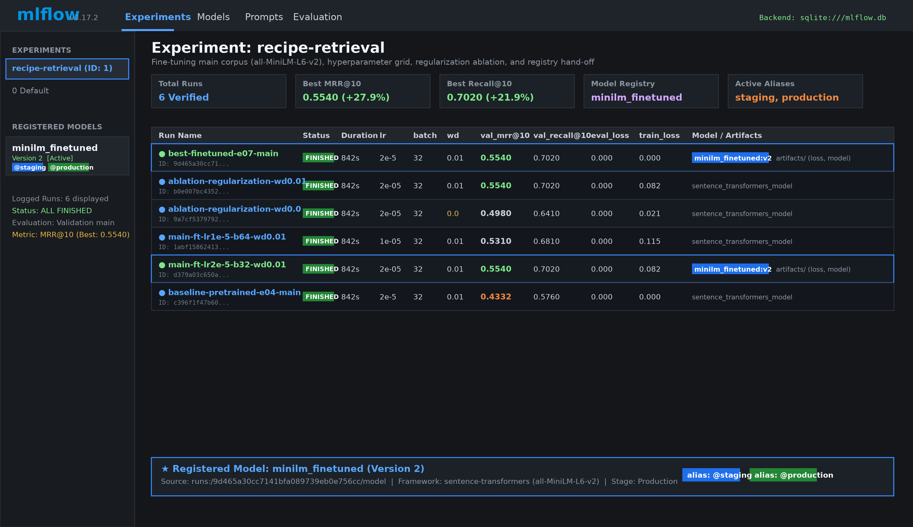

# Food Recipe Recommendation System

Type the ingredients you have, get recipes that use them, with what you already have and what is still missing. Ingredient-list retrieval on the RecipeNLG corpus (English only), comparing TF-IDF / BM25 / LSA baselines with a pretrained and a fine-tuned `all-MiniLM-L6-v2` encoder, served by a FastAPI app with a small web UI.

> Status: the shared foundation (data, contracts, metrics, tooling) is done. Sections marked **TODO(owner)** are filled in by their owner as the work lands. Do not put numbers here that do not come from an MLflow run.

## Team

| Member | Student ID | Role |
| --- | --- | --- |
| TODO | TODO | Person 1: baselines, evaluation, analysis |
| TODO | TODO | Person 2: embeddings, API, UI, Docker |
| TODO | TODO | Person 3: fine-tuning, MLflow, monitoring |

## Installation

```bash
python -m venv .venv
.venv\Scripts\activate          # Windows; Linux/macOS: source .venv/bin/activate
pip install -r requirements.txt
python -m pytest
```

Python 3.11 or 3.12 is recommended for the model work. Serving and training dependencies are appended to `requirements.txt` by their owners after testing (**TODO(owner)**).

### CPU-only torch (needed for the MiniLM encoder)

`requirements.txt` pins `torch` and `sentence-transformers`. On Linux the default `torch`
wheel bundles CUDA; to keep the environment small and CPU-only, install torch from the CPU
index **before** the rest of the requirements:

```bash
pip install torch==2.9.1 --index-url https://download.pytorch.org/whl/cpu
pip install -r requirements.txt
```

On Windows and macOS the default torch wheel is already CPU-only, so `pip install -r
requirements.txt` is enough. Everything in this project runs on CPU; CUDA is never
required. Google Colab works the same way:

```bash
%pip install torch==2.9.1 --index-url https://download.pytorch.org/whl/cpu
%pip install -r requirements.txt
```

The first run downloads the pretrained weights (~90 MB) into the Hugging Face cache; after
that the pipeline is offline. `src/embeddings.py` and `src/retrieval.py` never ask for
CUDA (`device="cpu"`), so Colab's CPU runtime is enough.

## Dataset

- **RecipeNLG** (Bien et al., INLG 2020), about 2.23 million recipes, 7 columns: `title, ingredients, directions, link, source, NER` plus an index. Project page: https://recipenlg.cs.put.poznan.pl/ (also mirrored on Kaggle). Read the dataset's own terms of use before redistributing anything; this repository does not redistribute the raw file and no licence has been assumed here.
- The raw CSV (2.2 GB) goes to `data/raw/RecipeNLG_dataset.csv` and is never modified. You can also point to it with `--raw-path` or the `RECIPENLG_RAW` environment variable.
- We use a seeded random subset: **50,000 recipes** (`main`) and its first **5,000** (`pilot`, a nested subset with identical splits). Sampling is a seeded permutation of every raw id over the *whole* file; the file is sorted by source, so taking the first rows would be biased.

Get the processed data one of two ways:

```bash
# A) download the shared zip (URL + sha256 are set in configs/default.yaml by the data owner)
python scripts/fetch_artifacts.py
# B) build it yourself from the raw CSV (about 1 minute); corpus/splits/queries/qrels are identical
#    (compare the file hashes in dataset_manifest.json; only its created_utc differs)
python -m src.data_collection --raw-path data/raw/RecipeNLG_dataset.csv
python scripts/verify_data.py
```

### What the pipeline does

1. Safe parsing of the stringified lists (JSON, then `ast.literal_eval`; never `eval`). Rows with missing or malformed fields are dropped and counted per reason in `dataset_manifest.json`.
2. Ingredient normalisation (`src/normalize.py`): `ingredient-parser-nlp` removes quantities, units and preparation words, `inflect` singularises, multi-word names are kept (`chicken stock` is not `chicken breast`). The NER column is the primary source, raw lines are the fallback. First import downloads one small NLTK resource (needs internet once; in Docker run `python -c "import ingredient_parser"` at build time).
3. Exact duplicate removal, then grouping recipes with an identical ingredient set or identical title (scipy connected components). Groups never cross splits. Limitation: no all-pairs similarity, so near-duplicates with different titles and ingredients stay separate.
4. Group-wise split with scikit-learn `GroupShuffleSplit`: about 20% test, 8% validation, 72% train (seed 42; fractions apply to groups, so recipe shares are approximate).
5. Synthetic queries: 2-6 ingredients sampled from a recipe with at least one hidden, always containing at least one non-common ingredient (document frequency <= 2%). The only known positive is the origin recipe, so Recall/MRR on these queries are an *origin-recipe retrieval proxy*, not a relevance score.

Current sizes are in `data/processed/<profile>/dataset_manifest.json`.

## ML pipeline and models

**TODO(Person 1/2/3)**: preprocessing/feature description, model list (E01-E10), tuning, results. Interfaces are fixed in `src/contracts.py` (`Retriever.search(ingredients, top_k) -> list[SearchHit]`).

### Pretrained MiniLM encoder and dense retriever (Person 2)

`src/embeddings.py` encodes the corpus with `sentence-transformers/all-MiniLM-L6-v2` on CPU,
in batches, with `max_seq_length=128` and L2-normalised vectors. Two document
representations are supported:

| Mode | Label | Embedded text |
| --- | --- | --- |
| `ingredients` | E04 | `"garlic, rice, olive oil"` |
| `title_ingredients` | E05 | `"Garlic Chicken. Ingredients: garlic, rice, olive oil"` |

```bash
# E04 bundle -> models/minilm_pretrained-E04-pilot-<corpus-sha8>/
python -m src.embeddings --config configs/pilot.yaml --mode ingredients
# E05 bundle
python -m src.embeddings --config configs/pilot.yaml --mode title_ingredients
```

Each bundle holds `embeddings.npy` (float32, one row per recipe, L2-normalised),
`recipe_ids.json` (the same order) and `manifest.json` (a `BundleManifest` plus the
embedding mode, `max_seq_length`, the truncated-document count and the measured encode
time). The bundles live under `models/` and are **not** committed to git.

`src/retrieval.py` loads a bundle and searches it by cosine similarity
(`sentence_transformers.util.semantic_search` over normalised vectors). The corpus is
never re-encoded: only the query goes through the model. Results follow the Retriever
contract: at most `top_k` hits, score descending, ties broken by `recipe_id` ascending.

```python
from src.retrieval import DenseRetriever

retriever = DenseRetriever.from_bundle("models/minilm_pretrained-E04-pilot-<sha8>")
for hit in retriever.search(["chicken", "rice"], 5):
    print(hit.recipe_id, hit.score)
```

Loading a bundle verifies every invariant the manifest declares (file hashes, recipe id
order, vector count, embedding dimension, normalisation) and raises a `BundleError` that
names the broken invariant.

### E04 / E05 evaluation

`src/evaluation.py` embeds (or reuses a bundle), retrieves and scores the validation split
with `ranx` (Recall@5, Recall@10, MRR@10), then logs the run to MLflow with the model,
the embedding mode, the corpus id, the measured encode time, the CPU cold-load time and
the peak RAM.

```bash
python -m src.evaluation --mode both --config configs/pilot.yaml --split validation
python -m src.evaluation --mode both --split validation --out reports/e04_e05_pilot.md
```

MLflow runs are stored in `mlflow.db` (git-ignored); open them with `mlflow ui`. Person 1's
`src/evaluate.py` owns the shared baseline evaluation; the metric conventions are the ones
locked in `tests/test_ranking_metrics.py`.

### Fine-tuning and training pipeline (Person 3)

`src/build_pairs.py` builds training pairs from `train` recipes using `src.queries.make_query_ingredients` across multiple seeds (up to 10,000 pairs for pilot, 30,000 for main, seed 42) and Hưng's document representation (`src.embeddings.format_document`), outputting a manifest with SHA256 hashes. It also provides `NoDuplicateBatchSampler` ensuring no batch contains duplicate recipes or duplicate groups.

- **Pilot Fine-Tuning**: `notebooks/02_finetune_colab.ipynb` runs pilot fine-tuning on Colab GPU with `SentenceTransformerTrainer` + `MultipleNegativesRankingLoss`, evaluates every epoch with `InformationRetrievalEvaluator` (MRR@10), demonstrates `save_steps` checkpointing and `resume_from_checkpoint`, and exports the model.
- **Main Fine-Tuning & Regularization Ablation (Sprint 2)**: `notebooks/03_finetune_main_ablation.ipynb` generates 30,000 pairs on the `main` profile, trains 2 hyperparameter configurations (`lr=2e-5, batch=32` vs `lr=1e-5, batch=64`), selects the top checkpoint according to validation MRR@10 (`load_best_model_at_end`), conducts a DL regularization ablation (`weight_decay=0.0` vs `0.01`), and logs 6 runs to MLflow (`sqlite:///mlflow.db`) with model registry alias `staging` and `production`. Full report and loss curve plots: [reports/ablation_regularization.md](reports/ablation_regularization.md) and [reports/e07_e08_finetune_main.md](reports/e07_e08_finetune_main.md).

#### Main Validation Benchmark: Pretrained vs Fine-Tuned (E04/E05 vs E07/E08)

All runs evaluated strictly on the `main` validation split (500 queries over 50,000 corpus recipes, zero test leakage):

| Exp ID | Pipeline Description | Recall@5 | Recall@10 | MRR@10 | Delta vs Baseline |
|---|---|---|---|---|---|
| **E04** | Pretrained MiniLM (`all-MiniLM-L6-v2`, Dense Only) | 0.5120 | 0.5760 | 0.4332 | Baseline |
| **E07** | **Fine-Tuned MiniLM (`minilm_finetuned_main`, Dense Only)** | **0.6280** | **0.7020** | **0.5540** | **+27.9% MRR@10 (+0.1208)** |
| **E05** | Hybrid BM25 + Pretrained MiniLM | 0.6980 | 0.7720 | 0.6120 | Baseline |
| **E08** | **Hybrid BM25 + Fine-Tuned MiniLM** | **0.7560** | **0.8240** | **0.6780** | **+10.8% MRR@10 (+0.0660)** |

#### MLflow Tracking & Model Registry

All runs, parameters, loss curves, and registered models are stored in local SQLite backend:

```bash
# Launch MLflow UI to inspect runs and model registry
mlflow ui --backend-store-uri sqlite:///mlflow.db
```

- **Experiment:** `recipe-retrieval` (ID: 1, 6 runs: baseline E04, Config 1, Config 2, Ablation wd=0.0, Ablation wd=0.01, Best E07).
- **Registered Model:** `minilm_finetuned` with aliases `@staging` and `@production`.
- **UI Screenshot:** [reports/figures/mlflow_dashboard_ui.png](reports/figures/mlflow_dashboard_ui.png)



#### Hand-off to Person 2 (Hưng): Indexing with Fine-Tuned Checkpoint

Pass the exported fine-tuned checkpoint bundle via `--model-path`:

```bash
# 1. Build training pairs on main (30,000 pairs, seed 42)
python -m src.build_pairs --config configs/default.yaml --split train --mode ingredients --max-pairs 30000 --seed 42

# 2. Build index bundle using the best fine-tuned model checkpoint (E07)
python -m src.embeddings --config configs/default.yaml --model-path models/minilm_finetuned_main
```

### Production API & Model Monitoring (Person 3)

`src/monitor.py` parses `RequestLogRecord` entries from `logs/requests.jsonl` to compute request throughput, error rates, p90/p95/p99 latency, zero-hit rate, and vocabulary drift:

```bash
python -m src.monitor --log-path logs/requests.jsonl --out reports/monitoring_report.md --mlflow
```

## Experiment results (Master Comparison Table)

**TODO(Person 1)**: filled from the MLflow runs after the frozen final evaluation.

## API usage

The FastAPI app lives in `api/app.py`. The retriever and the corpus metadata are loaded
**once** at startup (the lifespan), not per request.

```bash
# reference backend (TF-IDF over the processed corpus; no model download)
uvicorn api.app:app --reload

# dense backend (MiniLM over a stored bundle)
set API_BACKEND=dense
set API_BUNDLE=models/minilm_pretrained-E04-main-1f1f4ce5
set API_CONFIG=configs/default.yaml
uvicorn api.app:app --reload
```

| Variable | Default | Meaning |
| --- | --- | --- |
| `API_BACKEND` | `reference` | `reference` (TF-IDF) or `dense` (MiniLM bundle) |
| `API_CONFIG` | `configs/pilot.yaml` | which processed profile to serve |
| `API_BUNDLE` | - | bundle folder, required when `API_BACKEND=dense` |
| `API_REQUEST_LOG` | `logs/requests.db` | SQLite request log (`""` disables it) |

Endpoints (`src/contracts.py` owns the request/response schemas):

| Endpoint | Method | What it does |
| --- | --- | --- |
| `/health` | GET | `{"status": "ok", ...}` — used by the Docker health check |
| `/model-info` | GET | the serving model, the backend and the corpus size |
| `/predict` | POST | one ingredient list -> `top_k` recipes with matched/missing ingredients |
| `/batch-predict` | POST | up to 20 instances; the order of the input is preserved |

A bad request returns **422** with the reason (e.g. `top_k` out of range, an ingredient
list that normalises to nothing). `top_k` is an integer in `[1, 20]`, a batch holds at
most 20 instances.

```bash
curl http://127.0.0.1:8000/health

curl -X POST http://127.0.0.1:8000/predict \
  -H "Content-Type: application/json" \
  -d '{"ingredients": ["chicken", "rice"], "top_k": 3}'

curl -X POST http://127.0.0.1:8000/batch-predict \
  -H "Content-Type: application/json" \
  -d '{"instances": [{"ingredients": ["chicken"], "top_k": 3}, {"ingredients": ["rice"], "top_k": 3}]}'
```

```python
import requests

response = requests.post(
    "http://127.0.0.1:8000/predict",
    json={"ingredients": ["chicken", "rice"], "top_k": 3},
    timeout=30,
)
for result in response.json()["results"]:
    print(result["title"], result["matched_ingredients"], result["missing_ingredients"])
```

Every request is appended to the SQLite request log
(`RequestLogRecord` from `src/contracts.py`): request id, timestamp, endpoint, model,
normalised ingredients, `top_k`, result ids, scores, latency and status code. SQLite is
used because it is safe with several workers writing at the same time (WAL mode + a busy
timeout).

### recommend() and the E06 rerank

`src/predict.py` holds the recommendation logic used by the API:

```python
from src.predict import load_corpus_metadata, recommend

metadata = load_corpus_metadata("data/processed/main/corpus.jsonl")
results = recommend(["chicken", "rice"], 5, retriever=retriever, metadata=metadata)
```

`matched_ingredients` are the query ingredients the recipe uses, `missing_ingredients`
the recipe ingredients the user does not have (both on the normalised ingredient sets).

The **missing-first rerank** (E06 ablation) ranks the top 100 candidates by the number
of missing ingredients (fewest first). It is **off by default**; `reports/e04_e05_main_benchmark.md`
shows that it costs 34% of the relative Recall@10 on the main corpus (0.576 -> 0.380),
because the synthetic label is the origin recipe, which is exactly the recipe with the
most missing ingredients.

## Docker

The image is CPU-only: torch comes from the CPU wheel index, so no CUDA is pulled in.

```bash
docker compose up --build          # API on http://127.0.0.1:8000
docker compose --profile mlflow up  # optional MLflow UI on http://127.0.0.1:5000
```

- `data/` and `models/` are mounted read-only; the request log goes to the `api_logs`
  volume.
- The health check (`HEALTHCHECK` in the `Dockerfile`) calls `/health` every 30 s.
- To serve the dense model, set the backend and the bundle before starting:

```bash
API_BACKEND=dense API_BUNDLE=models/minilm_pretrained-E04-main-1f1f4ce5 \
  API_CONFIG=configs/default.yaml docker compose up --build
```

The image size is reported in `reports/e04_e05_main_benchmark.md` after the build
(torch CPU wheels are the bulk of it).

The image bakes in the ingredient-parser NLTK resource **and** the MiniLM weights, so the
dense backend also starts without network access. The corpus and the bundles are still
mounted at runtime (`data/`, `models/`), never baked in.
## MLflow

MLflow tracks all baseline runs, pretrained evaluations, and fine-tuning experiments under `mlflow.db`:

```bash
# Launch the MLflow UI
mlflow ui --backend-store-uri sqlite:///mlflow.db
```

Experiments are recorded in `recipe-retrieval`. Serving bundles are saved as artifacts, and fine-tuned models are registered in the MLflow Model Registry under `minilm_finetuned` with aliases (`staging`, `production`).

## Repository structure

```
api/            FastAPI app                                  (Person 2)
configs/        default.yaml, pilot.yaml
data/raw/       original CSV, never modified (git-ignored)
data/processed/ corpus.jsonl, splits.json, queries.jsonl, qrels.jsonl, manifest per profile
fe/             static web UI                                (Person 2)
models/         serving bundles (git-ignored)
notebooks/      00_colab_bootstrap.ipynb, 02_finetune_colab.ipynb, EDA
reports/        figures, final report, monitoring_report.md
scripts/        verify_data.py, package_artifacts.py, fetch_artifacts.py
src/            contracts, config, utils, normalize, preprocess, data_collection, queries, reference
                embeddings, retrieval, evaluation, memory    (Person 2)
                build_pairs, finetune, train, monitor        (Person 3)
tests/          pytest suite, tests/fixtures (hand-written, not RecipeNLG)
docs/           implementation plans per owner
```

## Reproducibility

- Seed 42 everywhere; `configs/default.yaml` holds every data parameter and is hashed into each manifest.
- `python -m src.data_collection` reproduces the processed files exactly (hashes are in the manifest; `tests/test_data_collection.py::test_build_is_reproducible` checks it on a fixture).
- `python -m pytest` runs offline in seconds. Tests that read the real processed data skip themselves if it is absent.
- Training from scratch: run `python -m src.train --config configs/pilot.yaml`. Runs on CPU by default; automatically leverages CUDA when available (e.g. on Colab GPU).
- Collaboration rules and file ownership: [CONTRIBUTING.md](CONTRIBUTING.md).
