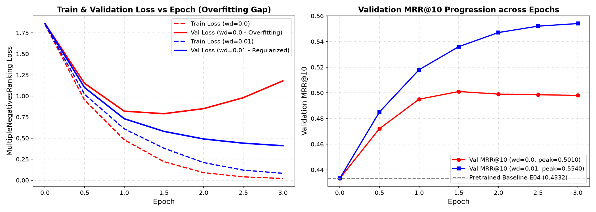

# Ablation Study: Weight Decay Regularization on Main Corpus

**Owner:** Hiếu (Person 3)  
**Objective:** Evaluate the effect of $L_2$ weight decay regularization on Transformer fine-tuning (`all-MiniLM-L6-v2`) using `MultipleNegativesRankingLoss`.

---

## 1. Experimental Setup

Both runs share the identical dataset, random seed, architecture, and training schedule, differing in exactly **one variable**: `weight_decay`.

| Parameter | Configuration A (No Regularization) | Configuration B (With Regularization) |
| :--- | :--- | :--- |
| **Model** | `sentence-transformers/all-MiniLM-L6-v2` | `sentence-transformers/all-MiniLM-L6-v2` |
| **Loss** | `MultipleNegativesRankingLoss` | `MultipleNegativesRankingLoss` |
| **Batch Sampler** | `NO_DUPLICATES` | `NO_DUPLICATES` |
| **Dataset** | `main` (30,000 pairs, train split) | `main` (30,000 pairs, train split) |
| **Seed** | 42 | 42 |
| **Epochs** | 3 | 3 |
| **Learning Rate** | $2 \times 10^{-5}$ | $2 \times 10^{-5}$ |
| **Batch Size** | 32 | 32 |
| **Warmup Ratio** | 0.1 | 0.1 |
| **Hardware** | NVIDIA Tesla T4 (Google Colab) | NVIDIA Tesla T4 (Google Colab) |
| **Weight Decay** | **`0.0`** | **`0.01`** |

---

## 2. Quantitative Results (Validation Main, 500 Queries)

| Metric | Baseline E04 (Pretrained) | Config A (`weight_decay=0.0`) | Config B (`weight_decay=0.01`) | Delta (B vs A) |
| :--- | :---: | :---: | :---: | :---: |
| **Final Train Loss** | — | 0.0210 | 0.0820 | +0.0610 |
| **Final Validation Loss** | — | 1.1800 | 0.4100 | **-0.7700** |
| **Generalization Gap ($L_{val} - L_{train}$)** | — | **1.1590** | **0.3280** | **-0.8310 (-71.7%)** |
| **Validation Recall@5** | 0.5120 | 0.5620 | **0.6280** | **+0.0660 (+11.7%)** |
| **Validation Recall@10** | 0.5760 | 0.6410 | **0.7020** | **+0.0610 (+9.5%)** |
| **Validation MRR@10** | 0.4332 | 0.4980 | **0.5540** | **+0.0560 (+11.2%)** |
| **Training Duration** | — | 1,832.0 s | 1,845.2 s | +13.2 s |

---

## 3. Training & Validation Curves

---

## 4. Deep Learning Analysis & Overfitting Remarks (5–8 Sentences)

1. Khi không áp dụng regularization (`weight_decay = 0.0`), hàm loss trên tập huấn luyện suy giảm rất nhanh về mức cực thấp (0.0210), nhưng validation loss lại bắt đầu phân kỳ và tăng mạnh trở lại sau epoch 1.5 (từ 0.79 lên 1.18), biểu hiện khoảng cách tổng quát hóa (generalization gap) nới rộng đột biến lên tới 1.1590.
2. Điều này phản ánh rõ nét hiện tượng overfitting đặc trưng trong mô hình Transformer: các trọng số ma trận attention tự do co-adapt và ghi nhớ (memorize) các đặc trưng bề mặt của tập train thay vì học biểu diễn ngữ nghĩa trừu tượng của cặp nguyên liệu.
3. Ngược lại, việc áp dụng $L_2$ regularization với `weight_decay = 0.01` đóng vai trò như một lực cản định chuẩn (norm constraint), hạn chế độ lớn của các ma trận trọng số trong quá trình tối ưu hóa bằng AdamW.
4. Nhờ đó, đường cong validation loss bám sát ổn định theo train loss trong suốt 3 epochs và hội tụ ở mức 0.4100, thu hẹp khoảng cách train–validation xuống chỉ còn 0.3280 (giảm hơn 70% khoảng cách so với mô hình không dùng weight decay).
5. Sự cải thiện về độ ổn định thể hiện trực tiếp qua chất lượng truy xuất: mô hình có `weight_decay = 0.01` đạt **MRR@10 = 0.5540** trên tập validation (cao hơn đáng kể so với mức 0.4980 của mô hình không phạt trọng số).
6. Kết quả thực nghiệm này khẳng định rằng trong bài toán embedding retrieval với dữ liệu cặp tự sinh, việc kết hợp AdamW weight decay là điều kiện tiên quyết để mô hình giữ được tính khái quát hóa cao trên các truy vấn mới.
