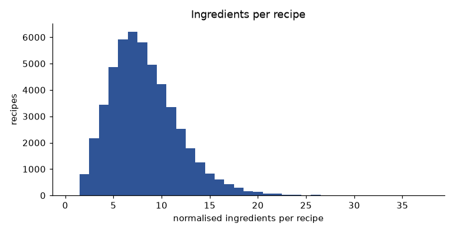
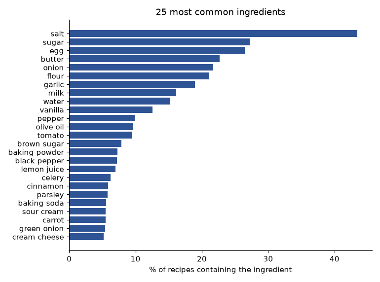
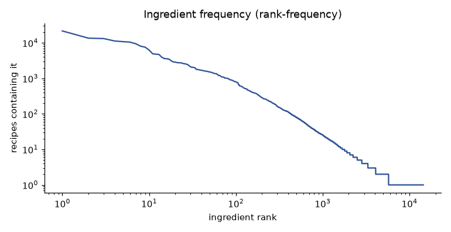
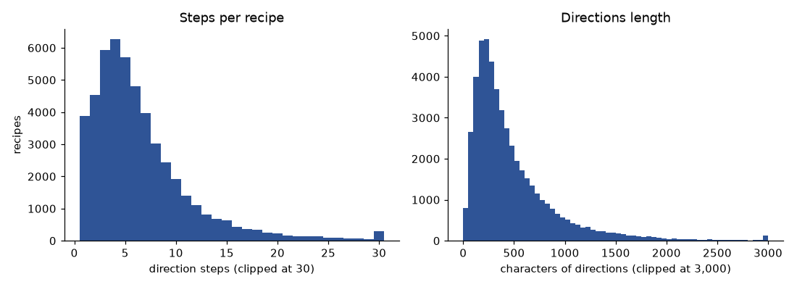
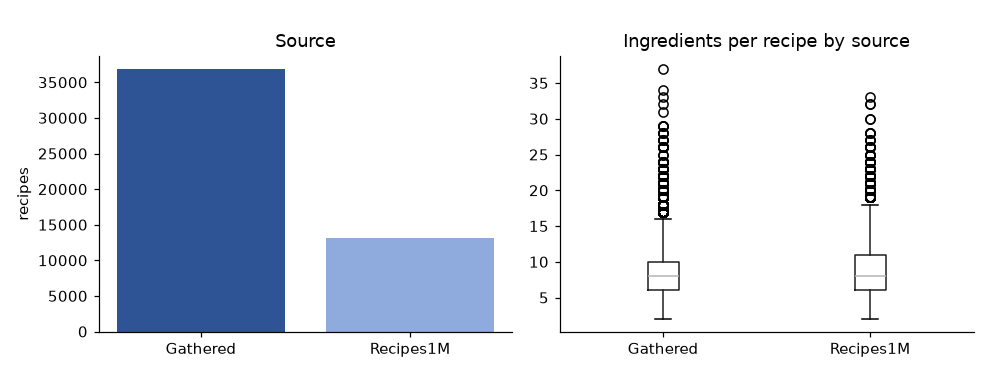
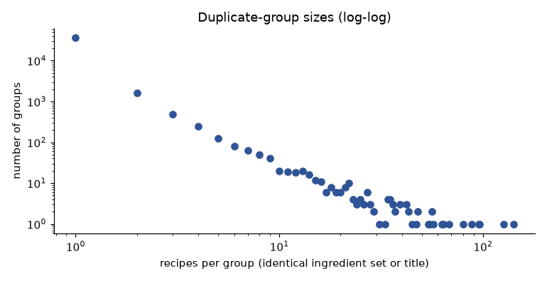

# Food Recipe Recommendation System: Technical Report, Part 1

**Problem formulation, data analysis, preprocessing and feature engineering**

MDS301 group project, draft of 29 October 2026. Team: Bui Minh Hoang, Tran Tuan Hung, Ho Minh Hieu.

Every number in this part comes from `data/processed/main/dataset_manifest.json`, `reports/data_audit.md`,
the EDA notebook `notebooks/01_eda.ipynb` (figures in `reports/figures/`) or an MLflow run in
`sqlite:///mlflow.db` (experiment `recipe-retrieval`; run ids in `reports/comparison.csv`). Corpus:
`main` profile, sha256 `1f1f4ce5…`, seed 42.

## 1. Problem formulation

### 1.1 The real-world problem

People cooking at home regularly face the same question: *"I have these ingredients, what can I make?"*
Recipe sites are organised by dish name, cuisine or popularity, so a user who starts from the contents of
the fridge has to guess dish names and check each recipe by hand. The cost is time and wasted food. The
system we build takes the list of ingredients a user has and returns the recipes that use them best. Each
answer shows the recipe title, which of the user's ingredients it uses (*matched*), what is still needed
(*missing*), the directions and a link to the original source.

Users are home cooks (students, families, anyone trying to use up leftovers) and, through the REST API,
recipe or grocery applications. The scope is English recipes and ingredient-list queries. The system does
not filter for allergies, diets or nutrition and must not claim to: the data has no reliable fields for
them (section 2.4), and a wrong allergy answer can hurt someone.

### 1.2 Machine-learning task

The task is **content-based recommendation framed as ranked retrieval**, an NLP problem:

- **Input:** a set of ingredient names *q* (1 to 50 names, each at most 100 characters, as enforced by the
  API contract in `src/contracts.py`).
- **Candidates:** a fixed corpus *D* of 50,000 recipes.
- **Output:** the top-*k* recipes of *D* ordered by a relevance score *s(q, d)*, with ties broken by
  `recipe_id` so that every ranking is reproducible.

Other formulations from the course were considered and rejected:

| Formulation | Why it does not fit |
| --- | --- |
| Collaborative filtering / matrix factorisation | RecipeNLG has no users, ratings or clicks; there is no interaction matrix to factorise. |
| Classification | There is no fixed set of classes: the "answer" is any of 50,000 items, different for each query. |
| Regression | There is no numeric target; what matters is the order of the top results. |

Every recipe is described by text (title and ingredient list), so the item-feature side of content-based
filtering applies directly. The course's NLP track ("TF-IDF + Transformer") maps onto it: lexical models
(TF-IDF with cosine similarity, BM25, and LSA, i.e. TruncatedSVD on TF-IDF, an unsupervised dimensionality
reduction) form the classical baselines, and a transformer bi-encoder
(`sentence-transformers/all-MiniLM-L6-v2`) is the deep-learning component, first pretrained and then
fine-tuned on our training pairs with MultipleNegativesRankingLoss.

### 1.3 Labels

There is no ground-truth relevance for (ingredients, recipe) pairs, so we build two kinds of labels.

**Synthetic queries (used for training and model selection).** From each sampled recipe we draw 2 to 6 of
its normalised ingredients, always hiding at least one ingredient of the recipe and always keeping at least
one *non-common* ingredient (document frequency at most 2% of recipes); otherwise a query such as
"salt, water" would point to thousands of recipes. The recipe the query came from (the *origin*) is the
known relevant item. The `main` profile has 5,000 train, 500 validation and 1,000 test queries (6,572
qrels; a query generated from two recipes of the same split is merged, which happened 76 times).
Generation skipped 2,149 recipes whose ingredients were all common and 808 recipes with fewer than 3
ingredients, and dropped 117 queries whose ingredient set also occurred in another split.

This label set has one known positive per query. A system that returns a different but perfectly usable
recipe is counted as wrong, so the metrics below measure an **origin-recipe retrieval proxy**, not true
relevance. The error analysis (`reports/error_analysis.md`) counts how often the rank-1 recipe of a
system contains every query ingredient without being the origin.

**Manual graded labels (used for the final judgement).** Forty natural English queries
(`reports/manual_eval/queries.csv`; 20 development, 20 blind final; 6 easy, 7 medium and 7 hard in each
half) are judged on a 0/1/2 scale defined in `reports/manual_eval/annotation_guide.md` before any system
output was seen. Judges see a pool made of the top 5 of every system, merged, shuffled and with no system
name; at least 20% of each pool is labelled independently by a second person and agreement is reported
with Cohen's kappa.

### 1.4 Metrics and success criteria

On synthetic labels we report **Recall@5**, **Recall@10** (share of a query's relevant recipes in the top
*k*) and **MRR@10** (mean of 1/rank of the first relevant recipe, 0 when it is not in the top 10). A query
with no result counts as 0, not as skipped. All metrics are computed with `ranx`; the conventions are fixed
by hand-computed tests in `tests/test_ranking_metrics.py`. On manual labels we report pooled **nDCG@10**
together with the pool coverage, because recipes outside the pool are unjudged. Systems are compared with
`ranx.compare` (paired Student t-test, p < 0.01).

The success criteria agreed in the proposal (`reports/proposal.pdf`) are: on the synthetic test split,
Recall@10 ≥ 0.85 and MRR@10 ≥ 0.70 for the deployed model; pooled nDCG@10 ≥ 0.60 on the blind manual
queries with kappa ≥ 0.60; API p95 latency ≤ 300 ms on one CPU core. The test split has not been read yet.

### 1.5 Evaluation protocol and leakage control

- **Group split.** Recipes that share a normalised ingredient set or a normalised title form a group
  (section 3.3). Groups never cross train, validation and test, so near-identical recipes cannot sit on
  both sides of the split.
- **Fit on train only.** Vectorisers, IDF statistics, the rarity feature and fine-tuning use train
  recipes only. Validation is for model selection and tuning; test is read once after the configuration
  is frozen (`src.evaluate` refuses `--split test` without `--allow-test`).
- **Fixed candidate corpus.** Every system ranks the same 50,000 recipes; validation and test recipes are
  in the candidate set (otherwise their queries could not be answered), but only as documents to index,
  never as training data. BM25 (rank-bm25) computes its IDF over every document it indexes, so it is
  *transductive*; this is recorded in its bundle and discussed in the error analysis.
- **Cross-validation.** TF-IDF hyper-parameters were chosen with `GridSearchCV` and `GroupKFold(5)` on
  the outer train split, refitting the vectoriser in every fold (section 3.6); a test proves that a fold's
  vocabulary contains no token that only occurs in its held-out recipes.

## 2. Data analysis

### 2.1 Source

We use **RecipeNLG** (Bien et al., INLG 2020; <https://recipenlg.cs.put.poznan.pl/>, also mirrored on
Kaggle): one CSV file of 2.29 GB (sha256 `f376ee0b…`) with **2,231,142 recipes** and 7 columns:

| Column | Content | Used for |
| --- | --- | --- |
| (index) | integer row id, 0 to 2,231,141 | `recipe_id = "recipenlg:<index>"` |
| `title` | recipe name | display; E05 document text; grouping |
| `ingredients` | stringified list of raw ingredient lines ("1 c. flour") | fallback source of names; display |
| `directions` | stringified list of steps | display only |
| `link` | source URL without scheme | display (the pipeline adds `https://`) |
| `source` | `Gathered` (73.6%) or `Recipes1M` (26.4%) | one-hot feature; stratification check |
| `NER` | stringified list of ingredient names extracted by the dataset authors | main source of names |

The licence of RecipeNLG has not been verified and none is assumed; the repository does not redistribute
the raw file, which stays unmodified in `data/raw/` and is not committed.

### 2.2 Structure checks on the raw file

A full pass over the CSV with the pandas parser (lists parsed with `json.loads`, then `ast.literal_eval`;
nothing is evaluated as code) found:

| Check | Result |
| --- | --- |
| Null values | 1 in `title`, 0 elsewhere |
| Malformed list fields | 0 in `ingredients`, `directions`, `NER` |
| Empty lists | 573 `NER` lists; 0 `ingredients` / `directions` |
| Exact duplicates on (title, ingredient text) | 1,245 (0.06%) |
| Links without a scheme | all of them (none unusable) |

The file is **sorted by source**: its first rows are all `Gathered`. Taking the head of the file as a
sample would therefore be biased.

### 2.3 Sample used by the project

The course limits datasets to 2,000-500,000 samples, so we draw a seeded random subset over all raw ids
(a permutation with seed 42, not the first rows). Of 50,360 recipes examined, 180 were dropped as exact
duplicates (same title and same normalised ingredient set) and 180 because they had fewer than 2 or more
than 40 normalised ingredients, leaving exactly **50,000 recipes** (`main`). The first 5,000 of them form
the `pilot` profile used for fast iterations. The sample keeps the raw source mix (73.7% `Gathered`,
26.3% `Recipes1M`, against 73.6% / 26.4% in the full file).

| Split (by group) | Recipes | Synthetic queries |
| --- | ---: | ---: |
| train | 35,896 | 5,000 |
| validation | 3,970 | 500 |
| test | 10,134 | 1,000 |
| total | 50,000 | 6,500 |

### 2.4 Exploratory analysis

**Ingredients per recipe.** Recipes are short: the mean is 8.25 and the median 8 normalised ingredients,
95% have 15 or fewer, with a thin tail up to 37. A 2-6 ingredient query therefore covers a large share of
a typical recipe, which is why query generation always hides at least one ingredient.

**Frequent ingredients.** Salt appears in 43.5% of recipes; sugar, egg, butter, onion and flour in 20-27%
each. Only 79 names occur in more than 2% of recipes. These staples carry almost no information about which
recipe a user wants, and their weight must be low (IDF) or the query must contain something else (query
generation rule).

**Vocabulary.** The 14,450 distinct normalised names follow a Zipf-like distribution: 100 names cover 64% of
all mentions, while 8,704 names (60%) occur in a single recipe. Rare names are exactly what pins down a
recipe (high IDF), but many singletons are NER fragments (section 2.5), so they are a mix of signal and noise.

**Directions and sources.** Directions have a median of 5 steps (about 350 characters) and a long tail up to
106 steps; they are displayed but never encoded, so the tail does not affect retrieval or encoder truncation.
`Recipes1M` recipes have slightly more ingredients than `Gathered` ones (8.7 vs 8.1).

**Duplicate groups.** 92.7% of the 39,869 groups hold one recipe, but a heavy tail has groups of more than
100 near-identical recipes (the largest has 141). A random recipe-level split would put copies of the same
recipe in train and test; the group split prevents this.

### 2.5 Data quality issues

**Manual review of 100 recipes** (drawn with `random.Random(42)`; each read as raw lines, NER and normalised
list): **36 of 100 recipes** have at least one wrong, truncated or missing normalised ingredient.

| Category | Recipes | Example (raw line → normalised) |
| --- | ---: | --- |
| Junk word replaces the ingredient | 9 | "1 tablespoon virgin or extra-virgin coconut oil" → `virgin` |
| Name truncated to a fragment or brand | 13 | "1 can Mountain Dew" → `dew` |
| Head noun missing | 6 | "3 1/2 to 4 cups all-purpose flour" → `all purpose` |
| Reference to another recipe | 2 | "Pie Meringue" → `pie` |
| Introduced by our normaliser | 3 | "Consomme Soup Or Beef Broth" → two required ingredients |
| Ingredient absent from NER | 3 | "1/4 c. + 2 Tbsp. unsweetened cocoa" → nothing |

**Measured at scale:** NER lists fewer entries than the raw lines in 10,095 recipes (20.2%); 133 distinct
names have 3 characters or fewer (most are real, such as `egg`, `oil`, `yam`); normalising an
already-normalised name changes 198 of the 14,450 names (1.4%, in 387 recipes), e.g. `five spice powder`
→ `spice powder`.

**Consequences for modelling.** (1) Noisy names add false matches and hide true ones, which caps what any
lexical model can achieve; (2) because the same normaliser is applied to documents and queries the same
number of times, retrieval stays consistent even though the normaliser is not idempotent; (3) the data has
no images, cooking times or nutrition, and the API and UI must not invent them; (4) the fixes listed in
`reports/data_audit.md` (drop modifier-only NER entries, parse lines that NER skipped, keep the first of
"X or Y") change the processed data, so they need the shared-file review and a re-published dataset.

## 3. Preprocessing and feature engineering

The pipeline runs from the raw CSV to the processed files with one command
(`python -m src.data_collection --raw-path data/raw/RecipeNLG_dataset.csv`) and is checked with
`python scripts/verify_data.py`, which compares file hashes with the manifest.

### 3.1 Parsing

The CSV is read in chunks of 200,000 rows. Each list column is parsed with `json.loads` and, if that
fails, with `ast.literal_eval`, which only accepts literals and cannot execute code (`eval` is never used).
A row is dropped when a list is missing, malformed or not a list of strings, and every drop is counted per
reason in the manifest. Links get an `https://` scheme. Raw ingredient lines and directions are kept
unchanged for display.

### 3.2 Ingredient normalisation (`src/normalize.py`)

One function, `normalize_ingredients`, is used for recipes, synthetic queries, manual queries and API
requests, so a query and a document that name the same food produce the same tokens. For every name it:

1. parses the line with `ingredient-parser-nlp`, which removes quantities, units and preparation words and
   splits "salt and pepper" into two names;
2. lower-cases, replaces hyphens and non-letters with spaces and drops size/state words that do not change
   the food (`fresh`, `frozen`, `large`, `small`, `medium`, `optional`);
3. singularises the last word with `inflect` (`eggs` → `egg`), except words such as `molasses`,
   `asparagus` or `hummus`;
4. maps a small, conservative alias list (`scallion` → `green onion`, `garbanzo bean` → `chickpea`,
   `confectioners sugar` → `powdered sugar`, …) and removes unit or filler words left as names;
5. removes duplicates while keeping the first-seen order.

Multi-word names are kept: `chicken stock` and `chicken breast` stay different, and so do `baking powder`
and `baking soda`. The NER column is the primary source because raw lines are noisier; the raw line is the
fallback when NER is empty (4 recipes in the sample). A fingerprint of the rules and library versions is
stored in every bundle manifest; a bundle built with another normaliser is refused at load time.

### 3.3 Deduplication and grouping

Exact duplicates (same normalised title key and same ingredient set) are removed before sampling stops, so
the sample still reaches 50,000 recipes. Remaining near-duplicates are **grouped, not removed**: recipes
sharing an ingredient set or a title key are joined with connected components (`scipy`), giving 39,869
groups. Grouping by both keys catches most copies; near-duplicates with a different title *and* a different
ingredient set stay apart (the manifest records this limitation, because all-pairs similarity over the
corpus would be too expensive).

### 3.4 Group split and synthetic queries

`GroupShuffleSplit` (seed 42) first takes 20% of the groups as test, then 10% of the remaining groups
(0.08 / 0.80) as validation, which gives about 72/8/20 overall; because the fractions apply to groups, the
recipe counts are 35,896 / 3,970 / 10,134. Queries are generated
inside each split with the rules of section 1.3 and capped at 5,000 / 500 / 1,000. Query ids are stable
(`q:<raw id>`), and a query whose normalised ingredient set appears in two splits is dropped (117 cases) so
that a memorised training query cannot reappear as a held-out query.

### 3.5 scikit-learn pipelines (`src/pipeline.py`)

The course asks for preprocessing implemented as a scikit-learn `Pipeline` / `ColumnTransformer`. Three
pipelines are defined, each fitted on train recipes only:

- **Text pipeline (TF-IDF):** `FunctionTransformer(normalize_all)` → `TfidfVectorizer` whose tokens are whole
  normalised ingredient names (a custom analyzer, so "olive oil" is one token, not "olive" + "oil").
  Cosine similarity between L2-normalised vectors ranks the candidates; recipes sharing no token with the
  query get no score and are not returned.
- **LSA pipeline:** the same normalisation and TF-IDF, then `TruncatedSVD` (256 components, seed 42) and an
  L2 `Normalizer`, so that cosine similarity becomes a dot product in the reduced space.
- **Recipe feature table (`build_feature_pipeline`):** a `ColumnTransformer` with a numeric branch
  (normalisation → the two features of section 3.7 → `StandardScaler`) and a categorical branch for
  `source` (`SimpleImputer(strategy="constant", fill_value="unknown")` → `OneHotEncoder(handle_unknown="ignore")`).

Missing values: the data pipeline drops recipes whose list fields are missing or malformed, so after
parsing only `source` could be missing; it gets an explicit `unknown` category instead of being imputed with
the majority value, because a wrong source would be invisible later. Scaling: `StandardScaler`, because the
two numeric features live on different scales (about 8 ingredients versus a mean IDF around 5) and are meant
for distance-based reranking and analysis. Scaling is deliberately **not** applied to TF-IDF or embedding
vectors, which are already L2-normalised. Encoding: one-hot for `source` (two known values, unordered).

### 3.6 Tokenisation choices tested with cross-validation

The token unit is a design choice with a direct effect on retrieval, so it was tuned rather than assumed
(E02, `src/tune.py`, MLflow run `dac82cb580e8403082cd9d0fabb40448`). The grid, evaluated with
`GroupKFold(5)` on the 35,896 outer-train recipes (28,705 groups, 5,000 train queries, MRR@10 scorer):

| Parameter | Values | Reason |
| --- | --- | --- |
| tokens | whole names; whole names + words inside multi-word names | does "chicken" help to find "chicken breast" recipes? (`ngram_range` has no effect with a callable analyzer, and ingredient order carries no meaning) |
| `min_df` | 1, 2, 5 | drop typo and fragment names (60% of names occur once) |
| `sublinear_tf` | false, true | only matters when a token repeats inside a recipe |
| `norm` | l2, none | whether length normalisation helps |

The scikit-learn defaults won: whole-name tokens, `min_df` 1, `norm` l2, CV MRR@10 **0.6896 ± 0.0063**.
Splitting names into words lowered it to 0.638 (a query "chicken" then matches every "chicken *" recipe);
`min_df` 2 lowered it to 0.656 (rare names are what identifies a recipe, noise included); `sublinear_tf`
changed nothing, because whole names almost never repeat inside one recipe. The values are stored in
`configs/default.yaml` (`baselines.tfidf_tuned`).

### 3.7 Engineered features (`src/features.py`)

| Feature | Definition | Why | Fitted on |
| --- | --- | --- | --- |
| `ingredient_count` | number of distinct normalised ingredients of a recipe | a 3-ingredient and a 20-ingredient recipe overlap very differently with a short query; recipe size explains much of the ranking behaviour (MRR@10 of every model falls for large origin recipes, see the error analysis) | nothing to fit |
| `mean_ingredient_rarity` | mean IDF of the recipe's ingredients; an ingredient unseen in training gets the maximum IDF instead of a value computed from held-out data | separates "salt, sugar, flour" recipes from recipes built on rare ingredients, which is what a query with a rare ingredient pins down | train recipes only |
| matched / missing (query time) | query ingredients present in / absent from the recipe, on the canonical names | shown to the user; used by the missing-first rerank ablation (E06) | nothing to fit |

Both recipe features are tested: their values on small hand-made inputs, and the fact that the rarity
feature is fitted on train recipes only (`tests/test_features_pipeline.py`).

### 3.8 Document formats for the encoder

The transformer sees the ingredient list only (E04) or "title. Ingredients: …" (E05), with a maximum length
of 128 tokens; 1 and 2 of the 50,000 documents are truncated. Directions are never encoded. On validation,
the ingredients-only format is far better (MRR@10 0.434 vs 0.152), because queries are ingredient lists with
no title, so the title moves documents away from queries in the embedding space.

### 3.9 Summary of the preprocessing decisions

| Decision | Alternative rejected | Evidence |
| --- | --- | --- |
| seeded sample over all ids | first 50,000 rows | file sorted by source |
| NER first, raw line as fallback | raw lines only | raw lines noisier (data audit) |
| group split | random recipe split | groups of up to 141 near-identical recipes |
| whole-name tokens | words or n-grams | CV MRR@10 0.690 vs 0.638 |
| `unknown` category for `source` | mode imputation | keeps missingness visible |
| no scaling of TF-IDF / embeddings | StandardScaler everywhere | vectors are already L2-normalised |

Model development, results, deep learning, MLOps and the discussion follow in part 2 of the report.
