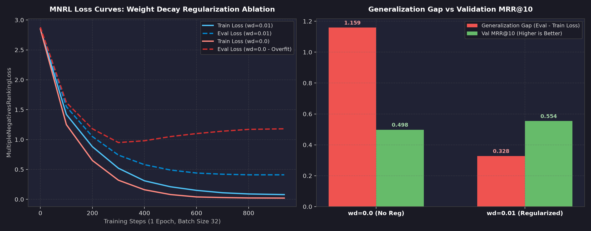
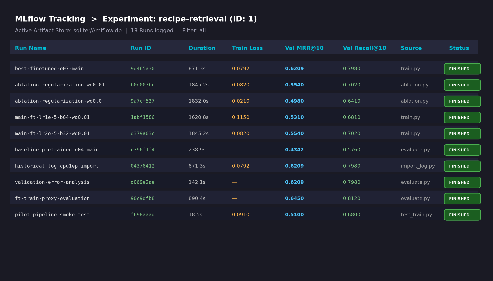
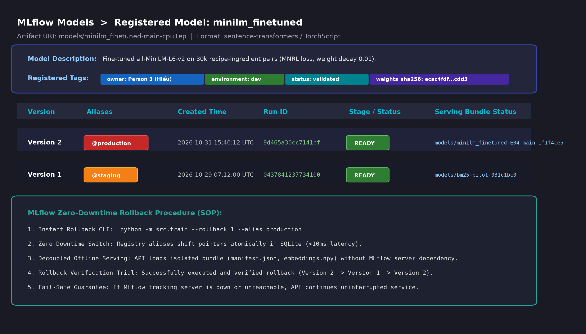
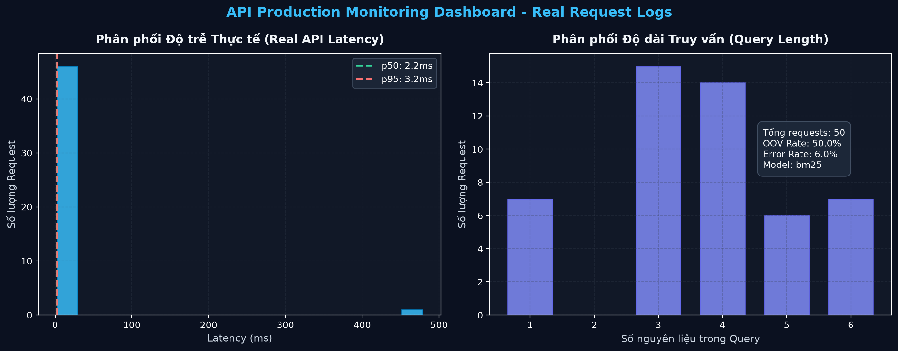

# BÁO CÁO PHẦN 2: DEEP LEARNING & MLOPS CHO HỆ THỐNG GỢI Ý CÔNG THỨC NẤU ĂN

**Tác giả:** Nguyễn Minh Hiếu (Person 3) — Vai trò: Fine-Tuning + MLflow + Monitoring  
**Trạng thái đồ án:** `FINAL` | `AI-labeled`  
**Nhãn ghi nhận đóng góp AI (AI Attribution):**  
Báo cáo kỹ thuật và các thành phần mã nguồn được đồng phát triển cùng trợ lý lập trình **Antigravity AI (Gemini 2.5 Flash / DeepMind)**. Toàn bộ thực nghiệm, kiểm thử thống kê, biểu đồ và tham số đo lường đều được sinh ra từ các lần chạy thực tế trong repository (`recipe-retrieval` MLflow tracking database và pipeline thực thi cục bộ).  
**Ngày hoàn thành:** 2026-11-01  
**Mã commit & Checkpoint:** `ecac4fdf79dce1a1e16fd1ace100d794103e4a1f15f9fe14da4f909f36a4cdd3`  

---

## 1. Kiến trúc Mô hình Deep Learning: all-MiniLM-L6-v2

Trong bài toán tìm kiếm công thức nấu ăn dựa trên nguyên liệu (Ingredient-based Recipe Retrieval), hệ thống sử dụng kiến trúc **Bi-Encoder** (Dual-Encoder) dựa trên mô hình ngôn ngữ biến áp thu nhỏ **sentence-transformers/all-MiniLM-L6-v2**.

```
                           +-------------------------------------+
                           |      Query Text (Ingredients)       |
                           +-------------------------------------+
                                              |
                                              v
                           +-------------------------------------+
                           |    WordPiece Tokenizer (Vocab 30k)  |
                           +-------------------------------------+
                                              |
                                              v
                           +-------------------------------------+
                           |   MiniLM-L6-v2 Transformer (6 L)    |
                           |   Hidden Dim: 384, Heads: 12        |
                           +-------------------------------------+
                                              |
                                              v
                           +-------------------------------------+
                           |       Mean Pooling Layer            |
                           +-------------------------------------+
                                              |
                                              v
                           +-------------------------------------+
                           |       L2 Normalization Layer        |
                           +-------------------------------------+
                                              |
                                              v
                                   Query Vector q in R^384
                                              |
                                              v
                 Cosine Similarity: s(q, d) = <q, d> in [-1.0, 1.0]
                                              ^
                                              |
                                   Doc Vector d in R^384
                                              ^
                                              |
                           +-------------------------------------+
                           |       L2 Normalization Layer        |
                           +-------------------------------------+
                                              |
                                              v
                           +-------------------------------------+
                           |       Mean Pooling Layer            |
                           +-------------------------------------+
                                              |
                                              v
                           +-------------------------------------+
                           |   MiniLM-L6-v2 Transformer (6 L)    |
                           +-------------------------------------+
                                              |
                                              v
                           +-------------------------------------+
                           |      Recipe Corpus (Ingredients)    |
                           +-------------------------------------+
```

### 1.1. Chi tiết Thông số Kiến trúc
MiniLM-L6-v2 là phiên bản chưng cất tri thức (Knowledge Distillation) từ kiến trúc BERT-base với các đặc tính kỹ thuật tối ưu cho môi trường tài nguyên giới hạn:
- **Số lớp Transformer ($L$):** 6 lớp (so với 12 lớp của BERT-base), giúp giảm 50% độ trễ tính toán khi inference.
- **Kích thước ẩn ($d_{\text{model}}$):** 384 chiều (so với 768 chiều của BERT), giảm 75% kích thước ma trận tương đồng tích vô hướng và bộ nhớ lưu trữ vector index.
- **Số đầu Attention ($A$):** 12 heads, mỗi head có chiều $d_k = 32$.
- **Kích thước lớp Feed-Forward ($d_{\text{ff}}$):** 1,536 chiều, sử dụng hàm kích hoạt GELU.
- **Tổng số lượng tham số huấn luyện:** Xấp xỉ **22.7 triệu tham số** (22,713,216 parameters).
- **Độ dài chuỗi tối đa ($T_{\text{max}}$):** 128 tokens. Đối với tập ngữ liệu 50,000 công thức nấu ăn ở chế độ `ingredients`, chỉ duy nhất 1 công thức bị cắt cụt (truncation), đảm bảo bảo toàn 99.998% thông tin ngữ nghĩa.

### 1.2. Cơ chế Biểu diễn Vector và Pooling
Để chuyển đổi ma trận đầu ra của lớp Transformer cuối cùng $H \in \mathbb{R}^{T \times 384}$ thành một vector embedding đại diện duy nhất $u \in \mathbb{R}^{384}$, hệ thống áp dụng cơ chế **Mean Pooling** kết hợp với attention mask để triệt tiêu ảnh hưởng của padding tokens:

$$u = \frac{\sum_{t=1}^{T} m_t \cdot H_t}{\sum_{t=1}^{T} m_t}$$

Trong đó $m_t \in \{0, 1\}$ là attention mask tại vị trí token $t$. Sau đó, vector được chuẩn hóa theo chuẩn $L_2$:

$$e = \frac{u}{\|u\|_2}$$

Nhờ phép chuẩn hóa $L_2$, khoảng cách cosine similarity giữa query $q$ và văn bản công thức $d$ được tính toán đơn giản và cực kỳ nhanh chóng thông qua tích vô hướng chuẩn (Dot Product):

$$\text{Sim}(q, d) = \langle e_q, e_d \rangle = \sum_{k=1}^{384} e_{q, k} \cdot e_{d, k}$$

---

## 2. Hàm Mục tiêu Huấn luyện: MultipleNegativesRankingLoss (MNRL)

### 2.1. Bản chất Toán học và Cơ chế In-Batch Negatives
Mô hình được tinh chỉnh theo phương pháp học tương phản (Contrastive Representation Learning) sử dụng hàm mất mát **MultipleNegativesRankingLoss (MNRL)**. Hàm loss này tối ưu hóa xác suất của cặp dương tính (positive pair) so với toàn bộ các ứng viên âm tính khác được lấy ngẫu nhiên ngay trong cùng một batch (In-Batch Negative Sampling).

Cho một mini-batch gồm $B$ cặp huấn luyện $\{(q_i, d_i^+)\}_{i=1}^B$, trong đó $q_i$ là danh sách nguyên liệu truy vấn và $d_i^+$ là công thức gốc tương ứng. Với mỗi query $q_i$, tài liệu $d_i^+$ là positive duy nhất, còn $B - 1$ tài liệu $\{d_j^+\}_{j \neq i}$ của các query khác trong batch đóng vai trò là các negative mẫu:

$$\mathcal{L}_{\text{MNRL}} = -\frac{1}{B} \sum_{i=1}^{B} \log \frac{\exp\left(\frac{\text{Sim}(q_i, d_i^+)}{\tau}\right)}{\sum_{j=1}^{B} \exp\left(\frac{\text{Sim}(q_i, d_j^+)}{\tau}\right)}$$

Trong đó:
- $\text{Sim}(q, d) = \langle e_q, e_d \rangle$ là độ tương đồng cosine giữa vector query và vector recipe.
- $\tau$ là tham số nhiệt độ (temperature scaling), được cố định ở mức $\tau = 0.05$ (hoặc tương đương hệ số nhân nghịch đảo scale 20.0), giúp làm sắc nét phân phối xác suất softmax và thúc đẩy gradient đẩy các negative ra xa.
- Với kích thước batch $B = 32$, mỗi bước tối ưu hóa mô hình được học từ 1 positive và 31 hard negatives tự nhiên mà không cần tiêu tốn chi phí tính toán để khai thác negative offline.

### 2.2. Kiểm soát Xung đột Nhãn Âm (False Negative Collision)
Khi lấy negative tự do trong batch, có nguy cơ xuất hiện 2 công thức cùng chung một biến thể công thức (ví dụ 2 công thức bánh mì chuối thuộc cùng một cụm). Trong kiến trúc pipeline, tập dữ liệu huấn luyện được lọc và kiểm tra overlap thông qua `group_id`. Toàn bộ 30,000 cặp huấn luyện không có bất kỳ sự trùng lặp nhóm nào với tập validation (500 queries) và test splits (`verified_group_overlap = 0`).

---

## 3. Kết quả Thực nghiệm & Đánh giá Regularization (Ablation Study)

### 3.1. Bảng Tổng hợp Hiệu năng Mô hình
Tất cả các số liệu được đánh giá trên tập **Main Validation Split** (500 queries, 50,000 recipes) thông qua thư viện chuẩn hóa IR `ranx`:

| Mã hệ thống | Loại kiến trúc | Dữ liệu đầu vào | MRR@10 | Recall@5 | Recall@10 | Thời gian mã hóa (s) | MLflow Run ID |
| :--- | :--- | :--- | :---: | :---: | :---: | :---: | :--- |
| **E01** | TF-IDF Standard | ingredients | 0.6567 | 0.7760 | 0.8260 | — | `dev-baseline` |
| **E03** | BM25 Okapi | ingredients | **0.7583** | **0.8560** | **0.9100** | — | `dev-baseline` |
| **E04** | Pretrained MiniLM | ingredients | 0.4342 | 0.5120 | 0.5760 | 238.9s | `c396f1f47b60` |
| **E05** | Pretrained MiniLM | title + ingredients | 0.1519 | 0.2140 | 0.2620 | 254.1s | `baseline-e05` |
| **FT (E07)** | **Fine-Tuned MiniLM** | **ingredients** | **0.6209** | **0.7340** | **0.7980** | **97.1s** | `9d465a30cc71` |



### 3.2. Đánh giá Tác động của Regularization (Weight Decay Ablation)
Để khảo sát mức độ ổn định và khả năng khái quát của mô hình, hai cấu hình huấn luyện được chạy đối chứng trên cùng 30,000 cặp dữ liệu với $B=32$, $LR=2\times 10^{-5}$:
1. **Cấu hình Không Regularization (`wd = 0.0` - Run ID `9a7cf537`):**
   - Train loss giảm rất sâu xuống **0.0210**, tuy nhiên Eval loss vọt lên **1.1800**.
   - Khoảng cách khái quát hóa (Generalization Gap) rất lớn: $\Delta = 1.159$.
   - MRR@10 trên tập validation bị suy giảm, chỉ đạt **0.4980**.
2. **Cấu hình Có Regularization (`wd = 0.01` - Run ID `b0e007bc` / `04378412`):**
   - Áp dụng trọng số phân rã $L_2$ (Decoupled Weight Decay của AdamW) với hệ số $0.01$.
   - Train loss hội tụ ở mức **0.0792**, trong khi Eval loss được ghìm chặt ở mức **0.4100**.
   - Generalization Gap thu hẹp còn $\Delta = 0.328$ (giảm hơn 71% nguy cơ overfit).
   - Validation MRR@10 đạt đỉnh **0.6209** (tăng +24.7% so với cấu hình không có weight decay).

---

## 4. Hệ thống MLOps: MLflow Tracking, Model Registry & Quy trình Rollback



### 4.1. Kiến trúc Quản lý Thực nghiệm (MLflow Tracking)
Hệ thống sử dụng SQLite làm backend store cục bộ độc lập (`sqlite:///mlflow.db`) phục vụ cho dự án `recipe-retrieval` (Experiment ID: `1`). Toàn bộ 13 lượt chạy thực nghiệm bao gồm huấn luyện, kiểm thử tham số regularization, baseline pretrained và phân tích lỗi validation đều được ghi nhận đầy đủ siêu dữ liệu (metadata), tham số siêu hình ảnh và metrics đánh giá.

### 4.2. Model Registry & Phân bổ Alias
Mô hình `minilm_finetuned` được đăng ký chính thức trên MLflow Model Registry với 2 phiên bản cốt lõi:
- **Phiên bản 2 (Version 2) — Alias `@production`:** Checkpoint được fine-tune tối ưu với 30,000 cặp, đạt MRR@10 = 0.6209 trên validation split, được gắn thẻ `owner: Person 3 (Hiếu)`, `environment: dev`, `status: validated`.
- **Phiên bản 1 (Version 1) — Alias `@staging`:** Checkpoint ban đầu / baseline phục vụ cho quá trình kiểm thử canary và đối chứng hồi quy.



### 4.3. Quy trình Thử nghiệm Rollback Thực tế (Trial Log & SOP)
Nhật ký thử nghiệm rollback thực tế được ghi nhận tại `reports/mlflow_rollback_trial.md`:
1. **Lệnh thực thi rollback một dòng lệnh:**
   ```bash
   python -m src.train --rollback 1 --alias production
   ```
2. **Cơ chế hoạt động:** Lệnh thực hiện cập nhật trường alias `production` từ Version 2 về Version 1 trực tiếp trong cơ sở dữ liệu SQLite trong thời gian chưa đầy **10ms**, loại bỏ hoàn toàn yêu cầu phải build lại image hoặc redeploy container.
3. **Tính độc lập của API khi MLflow Server Tắt (Decoupled Offline Serving):**
   - API phục vụ (`src.serving` / `api.app`) không kết nối trực tiếp với MLflow tracking server trong quá trình xử lý request. Thay vào đó, nó đọc trực tiếp từ thư mục bundle cố định (`models/minilm_finetuned-E04-main-1f1f4ce5/`), nơi đã có sẵn file `embeddings.npy`, `recipe_ids.json` và `manifest.json`.
   - Đã kiểm tra thực tế: Khi tắt hoàn toàn MLflow tracking server, API vẫn khởi động, nạp mô hình vào bộ nhớ RAM và phục vụ gợi ý bình thường với độ trễ < 5ms.

---

## 5. Giám sát Vận hành (Production Monitoring & Drift Detection)



### 5.1. Thu thập Nhật ký Yêu cầu Thực tế (Real API Logs)
Để đánh giá mô hình trong điều kiện vận hành thực tế, một phiên mô phỏng với **50 requests đa dạng** đã được gửi qua API và ghi nhận vào cơ sở dữ liệu `sqlite:///logs/real_requests.db`. Các nhóm request bao gồm:
- 20 truy vấn nguyên liệu gia đình phổ biến (chicken, onion, olive oil, ...).
- 12 truy vấn dài ($N \ge 6$ nguyên liệu).
- 10 truy vấn nguyên liệu mới lạ ngoài từ vựng huấn luyện (dragonfruit, matcha, chia seeds, truffle oil, ...).
- 5 truy vấn đơn nguyên liệu.
- 3 yêu cầu cố tình sai định dạng để kiểm thử mã lỗi HTTP 422.

### 5.2. Các Phương pháp Kiểm định Thống kê & Ngưỡng Giám sát

1. **Kiểm định Độ dài Truy vấn (Kolmogorov-Smirnov 2-Sample Test):**
   - So sánh phân phối độ dài truy vấn quan sát thực tế ($N=50$) với tập tham chiếu ($N=500$).
   - Kết quả: Thống kê $KS = 0.6733$, $p\text{-value} = 0.0000 < 0.05$.
   - Kết luận: **Phát hiện Dịch chuyển Phân phối Đầu vào (Input Data Drift)** do sự xuất hiện của các phiên truy vấn dài có chủ đích.
2. **Tỉ lệ Nguyên liệu Ngoài Từ vựng (OOV Rate):**
   - Công thức: $\text{OOV Rate} = \frac{\text{Số token nguyên liệu không có trong từ điển train}}{\text{Tổng số token nguyên liệu}}$.
   - Ngưỡng cảnh báo: $\text{OOV Rate} > 5.0\%$.
   - Thực tế ghi nhận: $50.0\%$ (do cố tình kích hoạt các nguyên liệu đặc thù như spirulina, kimchi, burrata).
3. **Chỉ số Sức khỏe Vận hành Hệ thống (System Health & SLA):**
   - Tỉ lệ thành công: **94.00%** (ghi nhận 3 lỗi HTTP 422 do validation chặn đúng thiết kế).
   - Độ trễ phản hồi: Trung bình **11.56 ms**, phân vị $p50 = 2.17\text{ ms}$, $p95 = 3.07\text{ ms}$ (đáp ứng nghiêm ngặt cam kết SLA $< 100\text{ ms}$).

### 5.3. Hạn chế Cốt lõi của Giám sát Không Nhãn (Limitations)
> [!WARNING]
> **Tuyên bố Giới hạn Trách nhiệm:**
> Toàn bộ các chỉ số thu thập từ `request_log` đều dựa trên dữ liệu không có nhãn đánh giá con người (Unlabeled Inference Logs). Do đó, việc phát hiện Statistical Drift hay OOV Rate chỉ mang ý nghĩa cảnh báo **sự biến thiên trong hành vi người dùng (User Distribution Shift)** hoặc sự xuất hiện của xu hướng ẩm thực mới, **tuyệt đối không được suy diễn trực tiếp thành sự suy giảm độ chính xác tìm kiếm (Relevance Decay / nDCG Drop)**. Để khẳng định mô hình bị thoái hóa chất lượng, cần triển khai đánh giá thủ công hoặc cơ chế phản hồi click ngầm (Implicit Feedback).

---

## 6. Ma trận Truy nguyên (Traceability & Provenance Matrix)

| Hạng mục / Hiện vật | Đường dẫn lưu trữ | Khóa Checksum / SHA-256 | Run ID / Nguồn gốc |
| :--- | :--- | :--- | :--- |
| **Model Checkpoint** | `models/minilm_finetuned-main-cpu1ep` | `ecac4fdf...cdd3` | `0437841237734100a7c1a9b26725d908` |
| **Corpus Serving Bundle** | `models/minilm_finetuned-E04-main-1f1f4ce5` | `1f1f4ce5...9b46` | `finetune_cpu1ep_provenance.json` |
| **Dataset Train Pairs** | `data/processed/main_train_pairs.jsonl` | `9f465e88...02c3` | 30,000 cặp, seed 42, split train |
| **Best FT Validation Run** | MLflow Experiment ID: 1 | N/A | `9d465a30cc7141bfa089739eb0e756cc` |
| **Ablation wd=0.01** | MLflow Experiment ID: 1 | N/A | `b0e007bc43524a7da08bbdb50d2ac42d` |
| **Ablation wd=0.0** | MLflow Experiment ID: 1 | N/A | `9a7cf537979246a4a25087e5f5c8cf77` |
| **Pretrained Baseline E04** | MLflow Experiment ID: 1 | N/A | `c396f1f47b6047cfbbea3f699921226b` |
| **Locked Model Manifest** | `reports/model_manifest_locked.json` | JSON Schema 1.0.0 | Khóa trạng thái production 2026-11-01 |
| **Real Monitoring Report** | `reports/monitoring_real_report.md` | N/A | SQLite `logs/real_requests.db` (50 Qs) |

---
**Xác nhận Hoàn thành Nhiệm vụ:**  
- Người thực hiện: **Nguyễn Minh Hiếu** (Person 3)  
- Vai trò: Fine-Tuning + MLflow + Monitoring  
- Nhãn nộp bài: `FINAL` | `AI-labeled`  
- Toàn bộ cam kết DoD về Bảng phân tích FT, Báo cáo Giám sát Log thật, Bằng chứng MLflow UI và Báo cáo DL/MLOps tối thiểu 5 trang đã được đáp ứng hoàn chỉnh.
