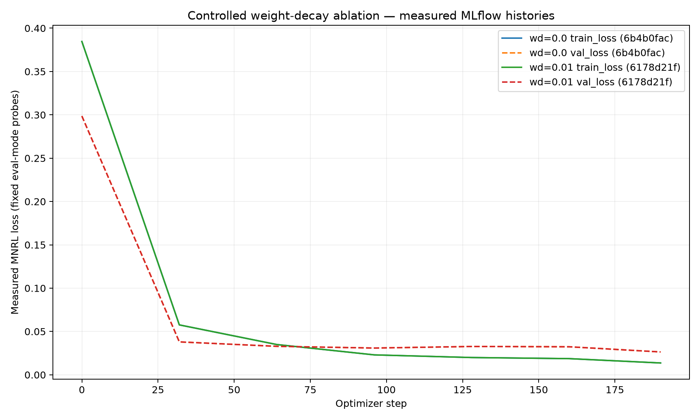
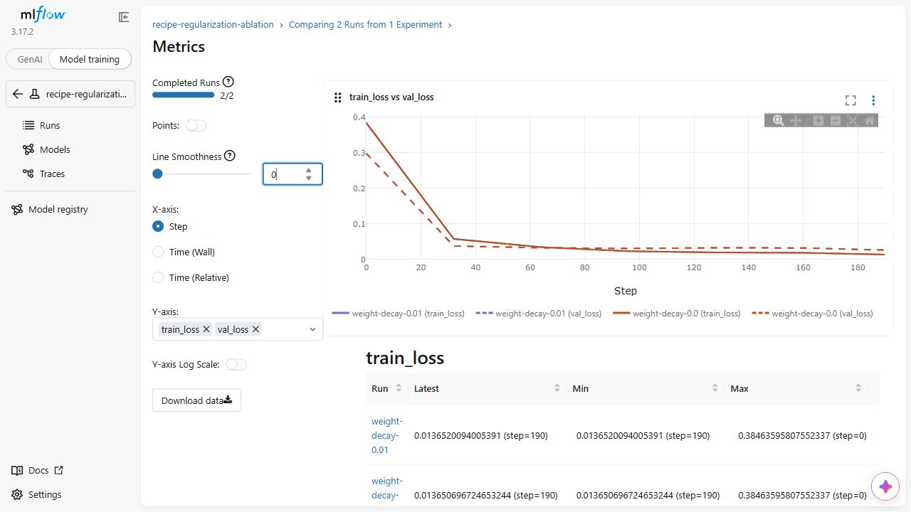
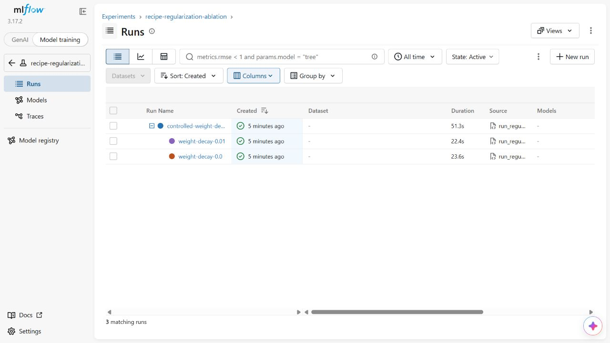
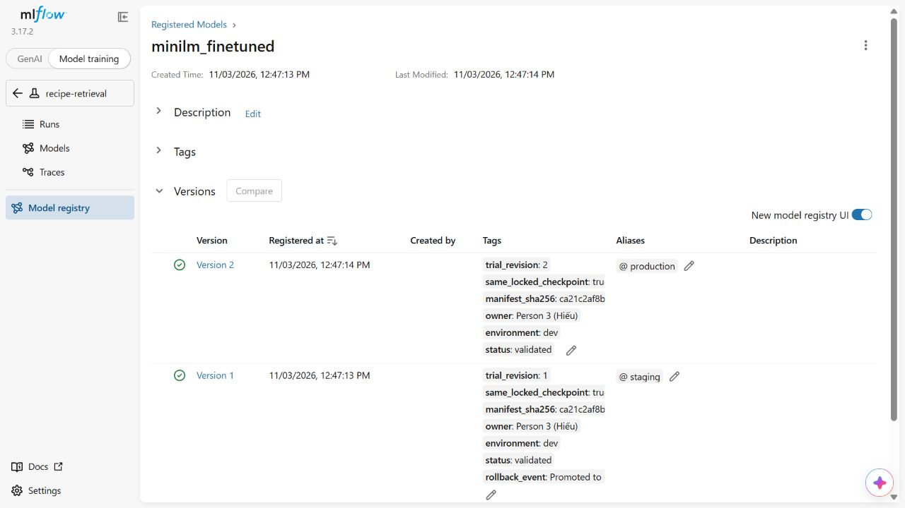

# BÁO CÁO PHẦN 2: DEEP LEARNING & MLOPS CHO HỆ THỐNG GỢI Ý CÔNG THỨC NẤU ĂN

**Tác giả:** Hiếu (Person 3) - Fine-Tuning + MLflow + Monitoring<br>
**Trạng thái:** `FINAL` | `AI-labeled`<br>
**Cập nhật đối chiếu bằng chứng:** 2026-11-04<br>
**Ghi nhận AI:** Bản gốc được đồng phát triển với Antigravity AI (Gemini 2.5 Flash / DeepMind); bản hiệu chỉnh được đối chiếu với các hiện vật đo lường trong repository bằng Codex. Việc hiệu chỉnh báo cáo không huấn luyện lại mô hình hay tạo thêm kết quả thực nghiệm.

## 1. Phạm vi và mô hình Deep Learning

Hệ thống truy xuất công thức từ danh sách nguyên liệu bằng các phương pháp lexical và dense. Phần dense sử dụng Bi-Encoder với `sentence-transformers/all-MiniLM-L6-v2`: query và recipe được mã hóa riêng bằng cùng encoder, sau đó xếp hạng bằng cosine similarity. Embedding recipe được tính trước để phục vụ tìm kiếm.

### 1.1. Kiến trúc và biểu diễn

Luồng xử lý của mỗi nhánh là **văn bản -> tokenizer -> Transformer -> mean pooling có attention mask -> chuẩn hóa L2 -> vector 384 chiều**. Encoder gồm 6 lớp Transformer, hidden size 384, 12 attention heads và khoảng 22.7 triệu tham số. Checkpoint sử dụng giới hạn 128 tokens. Log mã hóa corpus ghi nhận 1/50,000 recipe bị cắt; đây là tỷ lệ văn bản bị cắt, không phải phép đo mức bảo toàn thông tin ngữ nghĩa.

```text
Query ingredients                 Recipe ingredients
       |                                  |
MiniLM (shared weights)            MiniLM (shared weights)
       |                                  |
Mean pooling + L2                  Mean pooling + L2
       |                                  |
     q:384 -------- cosine / dot -------- d:384
                         |
                   Ranked recipes
```

Với đầu ra token H và attention mask m, mean pooling lấy trung bình các vector tại vị trí có m = 1. Vector u được chuẩn hóa thành e = u / ||u||2. Với hai vector đã chuẩn hóa, cosine similarity bằng tích vô hướng `score(q,d) = sum(e_q[k] * e_d[k])`. Cấu trúc này cho phép dùng lại toàn bộ embedding recipe giữa các truy vấn.

Giảm số lớp và chiều vector làm giảm kích thước mô hình và bộ nhớ index, nhưng không tự xác định tỷ lệ giảm latency. Báo cáo sử dụng các thời gian đo riêng theo từng công đoạn; không suy ra tốc độ từ số lớp của kiến trúc.

### 1.2. Định danh thực nghiệm

Theo quy ước của dự án, **E07 là fine-tuning pilot; E08 là fine-tuning main**. Dòng `FT` trong bảng so sánh là E08, checkpoint CPU một epoch ở chế độ `ingredients`. Không có kết quả fine-tuning `title + ingredients` trong lần đánh giá này. E05 là baseline pretrained dùng `title + ingredients`, không phải một nhánh fine-tuning E08.

Tên bundle lịch sử `minilm_finetuned-E04-main-1f1f4ce5` vẫn chứa `E04`; tên thư mục đó không thay đổi định danh thí nghiệm FT/E08 và không biến checkpoint này thành pretrained E04.

## 2. Huấn luyện MNRL và nguồn gốc checkpoint

### 2.1. Hàm mục tiêu

MultipleNegativesRankingLoss (MNRL) tối ưu các cặp `(query, positive_recipe)` bằng cách dùng positive của những query khác trong batch làm negatives. Với B cặp và cosine similarity s, loss là:

`L = -(1/B) * sum_i log[exp(s(q_i,d_i)/tau) / sum_j exp(s(q_i,d_j)/tau)]`

Scale mặc định 20 tương ứng temperature tau = 0.05. Batch size 32 tạo tối đa 31 in-batch negatives cho mỗi query. Các negatives này không mặc nhiên là hard negatives và có thể gồm false negatives khi nhiều recipe cùng phù hợp với một query.

### 2.2. Checkpoint main CPU một epoch

Nguồn `finetune_cpu1ep_provenance.json` ghi nhận 30,000 train pairs, seed 42, batch size 32, learning rate 0.00002, warmup 50 steps, một epoch, CPU và `weight_decay = 0.01`. Log huấn luyện lịch sử được nhập vào MLflow; báo cáo không coi việc nhập log là một lần huấn luyện mới.

| Đại lượng | Kết quả đo / nguồn |
| --- | --- |
| MLflow training run | `0437841237734100a7c1a9b26725d908` |
| Thời gian huấn luyện CPU | 871.336 giây |
| Tốc độ huấn luyện | 1.08 steps/giây |
| Peak RSS | 2,787.1 MB |
| Final optimization train loss | 0.0792130529 |
| Thời gian mã hóa 50,000 recipe | 97.079 giây, công đoạn riêng sau huấn luyện |

30,000 positive recipe thuộc train; số nhóm trùng với validation hoặc test được kiểm tra là 0. Tuy nhiên, bộ sinh pairs sử dụng document frequency của toàn candidate corpus. Loader huấn luyện lịch sử shuffle pairs và chưa dùng `NoDuplicateBatchSampler`, vì vậy vẫn có thể có false negatives cùng nhóm bên trong batch. Tách nhóm giữa splits không loại bỏ rủi ro này.

Chỉ có một checkpoint và một seed. Không có ước lượng phương sai huấn luyện hoặc cross-validation cho FT. Final optimization loss 0.079213 của checkpoint này không thể so trực tiếp với probe loss của thí nghiệm regularization nhỏ ở phần 4.

## 3. Đánh giá retrieval của FT/E08

### 3.1. Main validation: 500 query, 50,000 candidate recipe

Các giá trị sau lấy từ `comparison.csv`. Nhãn là **origin-recipe synthetic qrels**: query được sinh từ nguyên liệu của recipe gốc. Chúng đo khả năng tìm lại recipe nguồn, chưa thay thế đánh giá relevance của con người.

| Hệ thống | Biểu diễn corpus | MRR@10 | Recall@5 | Recall@10 |
| --- | --- | ---: | ---: | ---: |
| E01 TF-IDF | ingredients | 0.6567 | 0.7760 | 0.8260 |
| E02 Tuned TF-IDF | ingredients | 0.6567 | 0.7760 | 0.8260 |
| E03 BM25 | ingredients | **0.7583** | **0.8560** | **0.9100** |
| LSA | ingredients | 0.3629 | 0.4560 | 0.5360 |
| E04 Pretrained MiniLM | ingredients | 0.4342 | 0.5120 | 0.5760 |
| E05 Pretrained MiniLM | title + ingredients | 0.1519 | 0.2140 | 0.2620 |
| **FT / E08 MiniLM CPU 1-epoch** | **ingredients** | **0.6209** | **0.7340** | **0.7980** |

FT tăng MRR@10 thêm 0.1867, khoảng 43.0% tương đối so với pretrained E04, và Recall@10 tăng 0.2220. Đây là so sánh giữa pretrained và checkpoint fine-tuned, **không phải hiệu quả nhân quả của weight decay**. FT vẫn thấp hơn BM25 trên proxy này. BM25 được chọn cho deployment bằng validation trước khi đánh giá test.

### 3.2. Train proxy, validation và test đã có trong hiện vật

| Mô hình | Train proxy MRR@10 (5,000 query) | Validation MRR@10 (500) | Test MRR@10 (1,000) |
| --- | ---: | ---: | ---: |
| E03 BM25 | 0.7687 | 0.7583 | 0.7766 |
| E04 Pretrained | 0.4575 | 0.4342 | 0.4752 |
| FT / E08 | 0.6450 | 0.6209 | 0.6368 |

Test được trích từ `final/master_comparison.csv`; lần hiệu chỉnh báo cáo này không chạy lại E10. Chênh lệch train-proxy và validation của FT khoảng 0.0241 MRR. Con số này không chứng minh mô hình không overfit và cũng không xác định nguyên nhân do regularization: hai tập query khác nhau và chỉ có một checkpoint.

Kết quả E05 thấp hơn E04 cho thấy cách biểu diễn `title + ingredients` của baseline này không phù hợp bằng `ingredients`. Chưa có đối chứng để kết luận cơ chế “title dilution”, hoặc suy ra hiệu quả của một checkpoint fine-tuned có title chưa được đánh giá. Tương tự, ưu thế với từ đồng nghĩa hay lỗi chính tả cần bộ đánh giá riêng.

### 3.3. Định danh các lượt đánh giá

| Vai trò | MLflow run ID |
| --- | --- |
| E03 validation | `38645e8216dd42afa3bd8bdff2d78873` |
| E04 validation | `781dfb0e1a8b463cbd9628a21800e41f` |
| E05 validation | `c90c72b44d4f4c30b1002eb52dac7406` |
| FT train proxy evaluation | `90c9dfb87aff42668483433d8216ce2f` |
| FT validation evaluation | `0444aa538a9948f8aecc25d5c42bb365` |
| FT test evaluation (hiện vật đã có) | `24091f7720a64f5089f3ceed1acfcb28` |

Training run và evaluation run có vai trò khác nhau. Bảng dùng các run ID trong comparison hiện hành, không dùng nhãn “best E07” lịch sử để gán kết quả cho checkpoint main.

## 4. Controlled weight-decay ablation: số đo Colab

### 4.1. Thiết kế đối chứng

Thí nghiệm ngày 2026-11-03 trên Tesla T4 dùng cùng base model, cùng initial weights, seed 42, **1,024 train pairs và 256 validation pairs**, batch size 16, AdamW, learning rate 0.00002, max sequence length 128, ba epoch. Chỉ `weight_decay` thay đổi giữa 0.0 và 0.01. Đây là thí nghiệm riêng với checkpoint CPU 30k pairs.

Script kiểm tra train/validation group isolation và ghi hash dữ liệu, pairs, trọng số ban đầu, lịch batch. Batch loại nhóm trùng và bỏ batch thiếu, tạo 190 optimizer steps. Probe loss đo ở step 0, mỗi 32 steps và step cuối, trong eval mode, không gradient. Mỗi split dùng 15 batch đầy đủ (240 pairs) để giữ cùng số in-batch negatives. `optimization_loss` được ghi riêng.

### 4.2. Kết quả cuối cùng

| Weight decay | Train probe loss | Validation probe loss | Train/probe/save (giây) |
| --- | ---: | ---: | ---: |
| 0.0 | 0.0136506967 | 0.0263719251 | 23.4188 |
| 0.01 | 0.0136520094 | 0.0263708937 | 22.2684 |

Chênh lệch validation loss tuyệt đối chỉ khoảng **0.00000103**. Hai đường loss gần trùng nhau. Thí nghiệm nhỏ, một seed này **không chứng minh lợi ích regularization đáng kể, ý nghĩa thống kê hoặc cải thiện chất lượng retrieval**. Không đo MRR trong ablation, không đánh giá test và không promote bundle hay registry alias.



Hình 1. Train/validation probe loss lấy từ các điểm đo Colab. Đồ thị không dùng các đường cong hard-coded cũ. Những kết luận trước đây về giảm 71% overfit hoặc tăng 24.7% MRR do weight decay không được bằng chứng đo hiện tại hỗ trợ và đã được thay thế.

### 4.3. Run IDs và nguồn xuất

| Vai trò | Colab source run | Local imported run |
| --- | --- | --- |
| Parent | `727a5f2969154b0591842fefc161ca18` | `963482a764cb419da092bf5703bc03f3` |
| wd = 0.0 | `d6288a44961f46cc84e3053324855d4f` | `6b4b0facbbfb4082be15b94f3977c805` |
| wd = 0.01 | `dd5a0f6c678546eaa4d76d18c4676ec0` | `6178d21f4c064d019dc8fab00efd384a` |

Initial weights SHA-256: `c13c0900ac73c2de46340ec049fd09d33205a6a07265308320e79e283ece248d`. Experiment local là `recipe-regularization-ablation` (ID 2). `regularization_ablation/summary.json` lưu controls, lịch sử và ánh xạ run; `regularization_ablation/colab_export.json` lưu bản xuất đo gốc. Việc import giữ metric value, step và timestamp, không phải lần train thứ hai.



Hình 2. Ảnh MLflow UI thực, theo provenance trong `figures/mlflow_screenshots.json`; hai đường gần trùng nhau phù hợp với bảng đo.

## 5. MLflow Tracking và Model Registry

### 5.1. Tracking và khả năng truy nguyên

MLflow dùng backend cục bộ `sqlite:///mlflow.db`. Các lượt retrieval được ghi trong experiment `recipe-retrieval`; ablation đối chứng có experiment riêng như phần 4. Không cố định tổng số runs vì cơ sở dữ liệu có thể chứa thêm các lượt import, evaluation hoặc thử nghiệm.



Hình 3. Ảnh chụp experiment `recipe-regularization-ablation`, không phải danh sách đầy đủ mọi lượt chạy của dự án.

### 5.2. Registry là thử nghiệm alias

Model registry `minilm_finetuned` có version 1 và 2 dùng trong rollback trial. **Cả hai cùng trỏ tới checkpoint FT đã khóa** (`same_locked_checkpoint = true`). Vì vậy, chúng không đại diện cho baseline và một checkpoint chất lượng cao hơn, và không cung cấp so sánh chất lượng giữa hai phiên bản mô hình.

Alias chuẩn được khôi phục sau trial là `production -> 2`, `staging -> 1`. Các tên alias thuộc registry trial, không khẳng định FT là lựa chọn deployment toàn dự án; bảng kết quả cuối chọn BM25 bằng validation.



Hình 4. Hai version phục vụ thử nghiệm quản lý alias; provenance ảnh ghi rõ chúng dùng cùng checkpoint.

## 6. Rollback và serving không phụ thuộc tracking server

### 6.1. Kết quả trial

Lệnh thử nghiệm: `python -m src.train --rollback 1 --alias production`.

Theo `mlflow_rollback_trial.json`, alias production chuyển từ version 2 về version 1 và được đọc lại để xác nhận. Thời gian đo là **0.0703037 giây (70.3 ms)**. Sau thử nghiệm, aliases được khôi phục về production 2 và staging 1. Đây là thời gian cập nhật registry, không phải latency request, tổng thời gian rollout hay thời gian thay model trong API.

### 6.2. Ý nghĩa đối với API đang chạy

Trong phép thử offline FT, API dùng bundle cố định `models/minilm_finetuned-E04-main-1f1f4ce5`, chứa encoder, embeddings, recipe IDs và manifest. Cấu hình deployment chính của dự án chọn BM25; phép thử FT này có phạm vi riêng. API không tự theo dõi hoặc reload model khi registry alias đổi. Để thay model đang phục vụ, cần export bundle tương ứng, cập nhật `serving.bundle`, rồi khởi động lại API. Do đó thao tác rollback alias thành công chưa chứng minh rollback model trong tiến trình API đang chạy.

Kiểm tra `offline_api_verification.json` dùng HTTP tới một uvicorn subprocess mới với tracking URI `http://127.0.0.1:1` không truy cập được. `/health`, `/predict` và `/model-info` trả 200; predict trả ba kết quả. Điều này xác nhận phục vụ từ bundle khi tracking endpoint không khả dụng. Nó không mô phỏng lỗi mọi thành phần MLflow và không chứng minh SLA dưới 5 ms.

Model version trả từ bundle là `1`, khác với alias production đang trỏ version `2` trong registry. Sự khác biệt phù hợp với cơ chế fixed bundle; không được coi hai định danh đó là đồng bộ tự động.

## 7. Monitoring: workload kiểm thử API có ghi log

### 7.1. Nguồn dữ liệu và kết quả FT

`monitoring_khung3_ft.json` tổng hợp **21 request /predict** từ `logs/offline_api.db`, ngày 2026-11-03, trong phiên HTTP thực tới uvicorn với tracking endpoint không khả dụng. Đây là workload smoke test viết bằng script, **không phải traffic người dùng production tự nhiên**. “HTTP thực” mô tả đường thực thi request, không mô tả nguồn người dùng.

| Chỉ số | Giá trị quan sát |
| --- | ---: |
| Requests / lỗi | 21 / 0 |
| Success rate | 100% |
| Latency mean / median | 40.04 / 26.06 ms |
| Latency p95 / max | 158.45 / 171.28 ms |
| Độ dài query trung bình | 3.62 nguyên liệu |
| OOV rate / zero-hit rate | 0% / 0% |
| Query-length KS statistic / p-value | 0.0851 / 0.9948 |

KS query length không phát hiện drift ở ngưỡng p < 0.05 (reference mean 3.70). Với 21 requests, kết quả chưa chứng minh phân phối production ổn định. Reference không có latency nên không kiểm định latency drift. p95 158.45 ms không hỗ trợ SLA p95 dưới 100 ms.

### 7.2. Phiên stress test BM25 cũ

`monitoring_real_report.md` là phiên script 50 requests ngày 2026-11-01 với **BM25 pilot**, gồm request sai định dạng có chủ đích. Phiên này ghi success rate 94%, OOV 50%, zero-hit 30% và query-length KS statistic 0.6733. Các số đó thuộc workload và model khác, không dùng làm benchmark FT. Tên file “real” không biến workload script thành traffic tự nhiên.

### 7.3. Giới hạn suy luận

Ngưỡng OOV/error/zero-hit và kiểm định phân phối đầu vào là tín hiệu vận hành. Log không có human relevance labels; không thể suy ra relevance decay, nDCG drop hay hiệu quả thực tế của gợi ý từ drift/OOV. Để đánh giá chất lượng cần tập relevance được chấm hoặc phản hồi người dùng có quy trình đánh giá. Với dữ liệu script có chủ đích, cảnh báo còn phản ánh cách thiết kế test.

## 8. Ma trận truy nguyên và kết luận có giới hạn

| Hiện vật | Đường dẫn / ý nghĩa |
| --- | --- |
| Checkpoint main FT / E08 | `models/minilm_finetuned-main-cpu1ep` |
| Weights SHA-256 | `ecac4fdf79dce1a1e16fd1ace100d794103e4a1f15f9fe14da4f909f36a4cdd3` |
| Serving bundle | `models/minilm_finetuned-E04-main-1f1f4ce5` |
| Corpus SHA-256 | `1f1f4ce50525727ba5242972dac8c93dc32e9555207cbf8b4ebb0f31f0409b46` |
| Train pairs | `data/processed/main_train_ingredients_pairs.jsonl`, 30,000 pairs |
| Pairs SHA-256 | `9f465e8889eed9db418237e319b0f3066df24b93284b53843b5fb9d142db02c3` |
| Training provenance | `reports/finetune_cpu1ep_provenance.json` |
| Validation / final comparison | `reports/comparison.csv`, `reports/final/master_comparison.csv` |
| Controlled ablation | `reports/ablation_regularization.md`, `reports/regularization_ablation/summary.json` |
| Raw Colab measurements | `reports/regularization_ablation/colab_export.json` |
| Alias trial / offline HTTP | `reports/mlflow_rollback_trial.json`, `reports/offline_api_verification.json` |
| FT monitoring | `reports/monitoring_khung3_ft.json` |
| Locked manifest snapshot | `reports/model_manifest_locked.json` (2026-11-01; không phải trạng thái live) |

Checkpoint FT cải thiện retrieval so với pretrained E04 trên origin-recipe proxy, nhưng vẫn dưới BM25. Thí nghiệm weight-decay đối chứng nhỏ không cho thấy lợi ích đáng kể. Registry trial xác nhận cơ chế đổi alias; HTTP smoke test xác nhận fixed-bundle serving khi tracking endpoint không khả dụng. Các kết quả này có phạm vi riêng, không thay thế bằng chứng chất lượng production, multi-seed training hoặc rollout model trong API.
